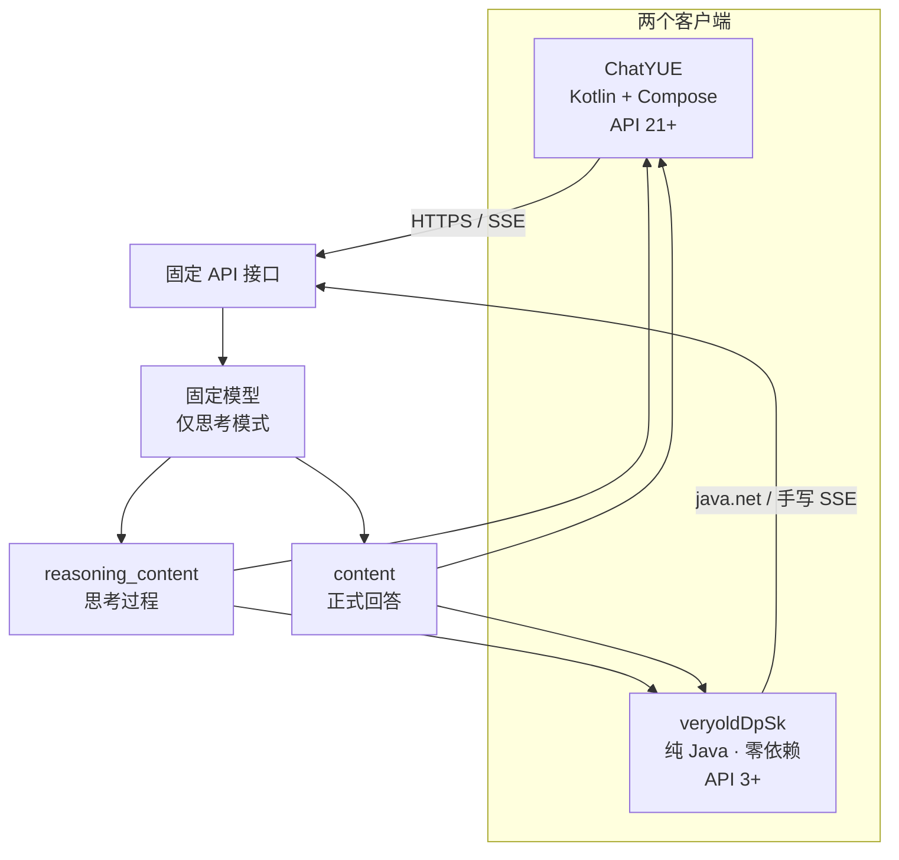
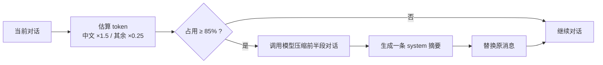
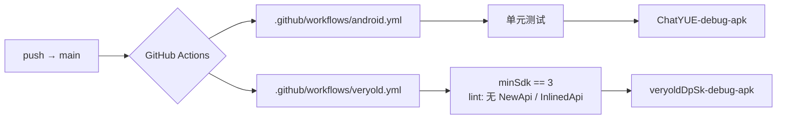
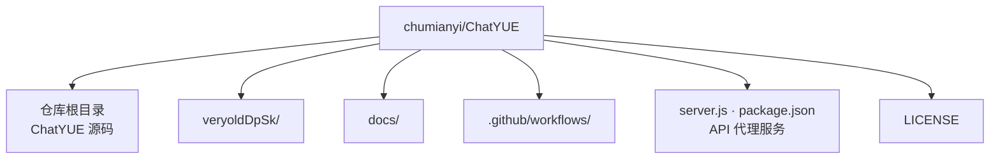

<div align="center">

<h1>ChatYUE&nbsp;/&nbsp;veryoldDpSk</h1>

<p><b>同一仓库内的两个 Android 聊天客户端，共用一套固定接口与固定模型。</b></p>

<p>
  <a href="https://github.com/chumianyi/ChatYUE"></a>
  
  
  
  
  
</p>

<p>
  
  
  
  
</p>

</div>

---

<a id="toc"></a>

## 📑 目录

| 章节 | 内容 |
|:---|:---|
| [一、项目概览](#overview) | 两个客户端的分工与架构 |
| [二、共同功能](#features) | 对话、上下文、侧边栏、周边 |
| [三、ChatYUE](#chatyue) | 主应用 · Kotlin + Compose |
| [四、veryoldDpSk](#veryolddpsk) | 超老设备 · 纯 Java · API 3+ |
| [五、构建与持续集成](#build) | GitHub Actions 工作流 |
| [六、仓库结构](#layout) | 目录布局 |
| [七、网页资源](#pages) | GitHub Pages |
| [八、技术栈总览](#stack) | 横向对比 |
| [九、许可证](#license) | GPLv3 |

---

<a id="overview"></a>

## 一、项目概览

| 应用 | 面向设备 | 技术栈 | 最低系统 |
|:---|:---|:---|:---|
| **ChatYUE** | 主流设备 | Kotlin + Jetpack Compose（HyperOS 设计语言） | Android 5.0（API 21） |
| **veryoldDpSk** | 超老设备 | 纯 Java，零第三方依赖 | Android 1.5（API 3） |

两者均由 [**DeepSeek Lite**](https://github.com/benzhoupo/deepseek-lite) 改造而来。

> [!NOTE]
> 两个应用共用**同一套固定接口、固定密钥、固定模型**，且**全部适配老手机**。差异只存在于 UI 层与构建链路，业务行为保持一致。



---

<a id="features"></a>

二、共同功能

<details open>
<summary><b>💬 对话核心</b></summary>

<br/>

· 固定接口、固定密钥、固定模型，仅思考模式（不支持切换）；
· 同时展示 reasoning_content 思考过程与 content 正式回答；
· 流式输出，可中途停止。

</details>

<details open>
<summary><b>📊 上下文管理</b></summary>

<br/>

· 右上角显示上下文占用百分比：中文 ×1.5、其余 ×0.25，上限 128K；
· 占用达到 85% 时自动调用模型，把前半段对话压缩成一条 system 摘要并替换原消息。

\text{tokens} \approx 1.5 \times N_{\text{中文}} + 0.25 \times N_{\text{其余}},\qquad
\text{占用率} = \frac{\text{tokens}}{128\text{K}} \times 100\%



</details>

<details open>
<summary><b>🧰 侧边栏</b></summary>

<br/>

工具 能力
智能翻译 中文 ⇄ 英 / 韩 / 日 / 俄；简体 ⇄ 繁体
一起作文 5 种风格 + 中英双语 + 100 ~ 2000 字数

</details>

<details open>
<summary><b>📱 应用周边</b></summary>

<br/>

· 检查更新与更新日志：读取 GitHub Pages 上的 start.json，不重新发版也能更新；
· 首次启动必须同意用户协议与隐私政策，点「<kbd>不同意</kbd>」直接退出；
· 附件：选择设备图片（自动提示模型仅支持识别文本）或读取 txt 文本文件；
· 对话记录按时间分组：今天 / 昨天 / 7 天内 / 30 天内 / 更早；
· 关于页面最下方提供「许可证」入口，可查看本项目与全部第三方开源组件的完整许可证文本。

</details>

---

<a id="chatyue"></a>

三、ChatYUE（主应用）

[!IMPORTANT]
源码位于仓库根目录。

项目 说明
界面 由 Jetpack Compose 重写，按小米 HyperOS / Miuix 设计规范自行实现顶栏、消息卡片、胶囊按钮与侧边栏
深色模式 跟随系统
应用图标 蓝色渐变气泡球：包含 5 档密度的传统图标、Android 8.0+ 自适应图标与 Android 13+ 主题图标
构建链路 Kotlin 2.4.20 + AGP 8.13.2 + Compose 1.9.0
最低系统 Android 5.0（API 21）

---

<a id="veryolddpsk"></a>

四、veryoldDpSk（超老设备）

[!WARNING]
最低版本由 CI 强制校验，不允许被抬高。

· 面向 Android 1.5（API 3）及以上所有系统；
· 零第三方依赖：不使用 AndroidX、不使用 Kotlin、不使用 OkHttp，全部为系统自带控件与 java.net；
· 手写 SSE 流式解析与 JSON 解析，避免不同年代 ROM 上的实现差异；
· 图标使用 PNG 位图（老系统不支持矢量图），主题基于 @android:style/Theme.Light.NoTitleBar；
· 运行时权限（相册）通过反射申请 + 轮询结果，代码中不出现任何高于 API 3 的符号；
· 源码位于 veryoldDpSk/ 目录，构建与主应用完全隔离（JDK 11 + AGP 7.4.2 + Gradle 7.5.1）。

<details>
<summary><b>为什么不用 AndroidX / Kotlin？</b></summary>

<br/>

Android 1.5（API 3）时代的 Dalvik 虚拟机、构建工具链与 ROM 实现差异极大：

1. AndroidX 的最低 API 要求远高于 API 3，无法参与编译；
2. Kotlin 标准库会引入额外的方法数与运行时依赖，在老 ROM 上存在兼容风险；
3. OkHttp 依赖较新的 TLS / 网络栈，在老设备上不可靠，故直接使用 java.net；
4. 矢量图（VectorDrawable） 从 API 21 起才被支持，因此图标退化为 PNG 位图；
5. 运行时权限模型从 API 23 才引入，因此通过反射调用并在低版本上安全降级。

</details>

---

<a id="build"></a>

五、构建与持续集成

两个应用都由 GitHub Actions 云端构建，推送到 main 即自动执行。

工作流 产物 额外校验
.github/workflows/android.yml ChatYUE-debug-apk 单元测试
.github/workflows/veryold.yml veryoldDpSk-debug-apk minSdk 必须为 3；lint 不得出现 NewApi / InlinedApi



[!TIP]
veryoldDpSk 的 lint 规则是「硬闸门」——只要出现任何 NewApi 或 InlinedApi 告警，构建即失败。这保证了代码中永远不会混入高于 API 3 的符号。

---

<a id="layout"></a>

六、仓库结构

```text
chumianyi/ChatYUE
├── .github/
│   └── workflows/
│       ├── android.yml          # ChatYUE 构建 + 单元测试
│       └── veryold.yml          # veryoldDpSk 构建 + minSdk / lint 校验
├── docs/                        # GitHub Pages 站点
│   ├── start.json               # 版本与更新日志数据源
│   ├── agreement.html           # 用户协议
│   └── privacy.html             # 隐私政策
├── veryoldDpSk/                 # 超老设备客户端（构建完全隔离）
├── server.js                    # API 代理服务
├── package.json                 # API 代理服务依赖
├── LICENSE                      # GNU GPL v3.0
└── ...                          # ChatYUE 主应用源码（仓库根目录）
```



---

<a id="pages"></a>

七、网页资源（GitHub Pages）

站点部署在 docs/ 目录：

文件 用途
start.json 版本与更新日志数据源
agreement.html 用户协议
privacy.html 隐私政策

[!NOTE]
客户端「检查更新」直接读取 start.json，因此更新文案与版本号无需重新发版即可生效。

---

<a id="stack"></a>

八、技术栈总览

维度 ChatYUE veryoldDpSk
语言 Kotlin 纯 Java
UI Jetpack Compose（HyperOS / Miuix 风格） 系统自带控件
最低 API 21（Android 5.0） 3（Android 1.5）
第三方依赖 Compose 等 零
网络 标准 HTTPS / SSE java.net + 手写 SSE
JSON 标准解析 手写解析
图标 自适应图标 + 主题图标 + 5 档密度 PNG 位图
主题 跟随系统深色模式 Theme.Light.NoTitleBar
构建 Kotlin 2.4.20 / AGP 8.13.2 / Compose 1.9.0 JDK 11 / AGP 7.4.2 / Gradle 7.5.1
源码位置 仓库根目录 veryoldDpSk/

---

<a id="license"></a>

九、许可证

本项目使用 GNU General Public License v3.0 开源，详见 LICENSE。

· 原项目：DeepSeek Lite
· 项目地址：

[!IMPORTANT]
仓库根目录下的 server.js / package.json 为 API 代理服务代码，与两个 Android 客户端同仓保存。

<details>
<summary><b>GPLv3 简要说明</b></summary>

<br/>

· ✅ 可以自由使用、修改、分发本项目；
· ✅ 分发修改后的版本时，必须同样以 GPLv3 开源，并提供完整源码；
· ✅ 必须保留原始版权声明与许可证文本；
· ❌ 不提供任何担保。

完整条款请参见 LICENSE 或 。

</details>

---

<div align="center">
<sub>

ChatYUE / veryoldDpSk · 让每一台老手机都能用上 AI 对话

Made with ❤️ for old devices

</sub>
</div>

## 正式版与签名

从 v1.4.1 起，云端构建产出的是 **release 正式版**（`assembleRelease`），不再提供 debug 包。

- 签名使用仓库内固定的 keystore：`keystore/chatyue-release.jks`，配置见 `keystore.properties`
- 两个应用（ChatYUE 与 veryoldDpSk）共用这份签名，各自都有 release 正式版
- 本地与云端 CI 共用同一份签名，因此每次产出的 APK 都能互相覆盖安装
- 正式版 `android:debuggable=false`，体积与运行效率均优于 debug 包
- 未开启代码混淆与资源压缩（`optimization.enable = false`），避免运行期异常

证书指纹（SHA-1）：`1C:9F:56:BE:79:11:80:F5:79:CC:6D:3B:46:45:B2:07:9E:D1:57:62`

> 由于本仓库公开，keystore 与口令同样是公开的。如果担心他人冒名签发同包名应用，
> 请替换为自己的私有 keystore，并把 `keystore.properties` 从仓库中移除、
> 改用 CI Secrets 注入。
>
> 从旧版 debug 包升级到正式版需要先卸载旧版（两者签名不同，无法直接覆盖）。

产物：`app/build/outputs/apk/release/ChatYUE-<版本号>-release.apk`
